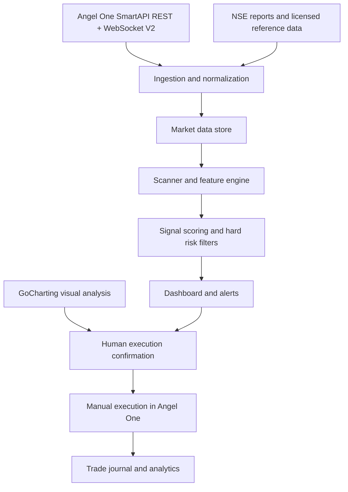

# IADEW — Institutional Activity Detection & Execution Workstation

A Windows-first research and alerting workstation for NSE cash equities and index futures using **Angel One SmartAPI** and GoCharting for visual order-flow confirmation.

> Version 0.2 is alert-only. It does not place orders. Scanner scores rank candidates; they are not probabilities and do not identify institutional participants.

## Selected stack

- Windows 10/11, Python 3.11+
- Angel One SmartAPI: TOTP login, daily scrip master, historical candles and WebSocket V2 quotes
- GoCharting: visual footprint, CVD, volume profile and DOM confirmation; use only documented/export-permitted data access
- Python, pandas, NumPy
- SQLite initially; PostgreSQL/TimescaleDB when required
- Streamlit local dashboard; Telegram notifications in a later phase

## Architecture



## Implementation flow

1. Authenticate with Angel One SmartAPI using API key, client code, PIN and TOTP.
2. Download/cache Angel One's official daily OpenAPIScripMaster instrument file.
3. Resolve NSE cash symbols to their Angel One symbol tokens and front-month NIFTY/BANKNIFTY futures to NFO tokens.
4. Load historical 5-minute candles and calculate time-of-day RVOL, VWAP, EMA trend, momentum and traded value.
5. Use the SmartAPI WebSocket V2 adapter for live quote streaming; normalize packets before feature updates.
6. Aggregate received ticks into local 1-minute and 5-minute OHLCV candles in SQLite.
7. Add independently sourced aggressor-side trade data before calculating true delta/CVD/footprint. Do not infer these from OHLCV candles.
8. Add liquidity sweeps, absorption candidates, volume-profile context and futures OI/basis features.
9. Add evidence-based setup scoring, hard risk gates and alert deduplication.
10. Paper trade, model costs/slippage, walk-forward test and review out-of-sample results.
11. Keep order entry manual in v1; review current SEBI/exchange/broker rules before any automated order routing.

## Run live candle collection

In PowerShell from the repository root, after installing requirements and running `python auth.py`:

```powershell
python run_live_feed.py
```

Keep this process running during market hours. In a second PowerShell window, run:

```powershell
streamlit run dashboard.py
```

The dashboard reads the SQLite `live_bars` table and displays 1-minute/5-minute candles. Stop the collector with Ctrl+C. The collector does not place orders.

## Data truth and limitations

- Angel One LTP values are normalized from paise to rupees in the live candle aggregator.
- Volume is calculated from changes in cumulative day volume. The first received packet per token establishes the volume baseline; it is not counted into a candle. Reconnects or day-volume resets should be reviewed.
- OHLCV-derived RVOL/VWAP/EMA are context features, not institutional-flow evidence.
- SmartAPI WebSocket quote/depth packets provide market-data snapshots, not a complete sequenced order-event feed.
- OI changes do not identify the participant or prove direction by themselves.
- Footprint/CVD quality depends on the provider's trade-side classification and licensed feed.
- Do not scrape GoCharting or reverse-engineer private endpoints.

## Local setup

See [docs/INSTALL_WINDOWS.md](docs/INSTALL_WINDOWS.md), [docs/DATA_ARCHITECTURE.md](docs/DATA_ARCHITECTURE.md), [docs/SCANNER_SPEC.md](docs/SCANNER_SPEC.md), [docs/RISK_ENGINE.md](docs/RISK_ENGINE.md), and [docs/IMPLEMENTATION_ROADMAP.md](docs/IMPLEMENTATION_ROADMAP.md).

Copy `.env.example` to `.env`; add Angel One credentials locally. Never commit `.env`.

## Repository status

Angel One historical-data scanner, TOTP login helper and WebSocket V2 adapter are starter integrations. They still require validation with the account owner's SmartAPI app and live session. Treat all scores as research scaffolding until independently validated. No live-trading performance is claimed.

## Official references

- [Angel One SmartAPI documentation](https://smartapi.angelone.in/docs)
- [Angel One official Python SDK](https://github.com/angel-one/smartapi-python)
- [Angel One instrument master](https://margincalculator.angelone.in/OpenAPI_File/files/OpenAPIScripMaster.json)

Market data remains subject to the relevant provider/exchange terms.


## Historical replay and paper trading (90 sessions)

After `python auth.py`, run this from the repository root:

```powershell
python run_backtest.py --days 90 --timeframe FIVE_MINUTE --style both
```

The command downloads 5-minute history for the configured NSE cash watchlist plus the current front-month NIFTY and BANKNIFTY futures, then runs separate intraday and swing OHLCV-only paper strategies. The requested 90 sessions are translated to a calendar lookback and fetched in windows of at most 90 calendar days to stay below the documented 100-day 5-minute request ceiling. Actual returned history may be shorter depending on Angel One availability and instrument history.

Results are saved to SQLite tables `replay_bars`, `backtest_runs` and `backtest_trades`; open `streamlit run dashboard.py` to inspect run metrics and trades.

### Backtest assumptions and limitations

- Signal calculated at bar close; simulated entry at the next bar open to reduce look-ahead bias.
- Intraday strategy: EMA9/EMA20 trend, session VWAP and EMA9 recross; positions are not carried overnight.
- Swing strategy: 20-bar breakout with EMA9/EMA20 trend filter; maximum holding horizon is 60 five-minute bars.
- Initial stop is 1.5 x ATR(14); target is 2R. If stop and target are both touched in one OHLC bar, stop is assumed first.
- Indicative default costs are 3 bps per side plus 1 bp slippage per side. Replace with measured broker/exchange charges and realistic instrument-specific slippage before interpreting results.
- Default paper capital is ₹5,00,000 and risk budget is 0.5% per trade. This is a research default, not a recommendation.
- Futures sizing in this MVP is simplified to price-unit exposure and does not yet enforce contract lot size, SPAN/exposure margin, expiry roll, or portfolio correlation. Treat futures P&L as indicative only.
- No order placement is implemented. These are backtest simulations, not live/paper broker orders.
- OHLCV cannot establish true aggressor delta, footprint, absorption, or institutional participation.
- Current front-month futures history may not represent a continuous rolled futures series; expiry/roll handling is a future improvement.
- Results are exploratory, not evidence of future profitability. Use out-of-sample periods and avoid optimizing on the same period used for evaluation.

See [docs/HISTORICAL_REPLAY.md](docs/HISTORICAL_REPLAY.md) for details.


## Live NSE cash Depth20 collection

After `python auth.py`, run:

```powershell
python run_live_feed.py --depth
```

This separate collector stores Angel One NSE cash Depth20 snapshots in SQLite
table `depth_snapshots`; the dashboard displays the latest stored bid/ask
levels. The official SDK currently restricts Depth mode to NSE cash (exchange
type 1) and at most 50 tokens. The ordinary `python run_live_feed.py` quote
collector remains unchanged and continues to collect NSE cash plus NFO futures
quotes/candles. Depth snapshots are displayed liquidity, not sequenced order
events or trade aggressor prints; they cannot produce true CVD or footprint
delta. See [docs/LIVE_DEPTH.md](docs/LIVE_DEPTH.md).


## Validate depth pressure against subsequent price movement

For meaningful validation, use the combined collector so each NSE cash instrument
has both Depth20 snapshots and 1-minute quote candles on the same WebSocket:

```powershell
python run_live_feed.py --depth
```

Leave it running during market hours over multiple sessions. Then run:

```powershell
python run_depth_validation.py --days 5
```

The report matches each depth snapshot to the first available 1-minute candle at
or after the snapshot and measures subsequent 1-minute and 5-minute close returns.
It exports raw matched observations and grouped summaries under `reports/`.
Results are descriptive only: candle matching is approximate, and the report
does not model executable fills, spread, fees, slippage, or causality. Do not
use the output as a trading signal or optimize thresholds on a small sample.
