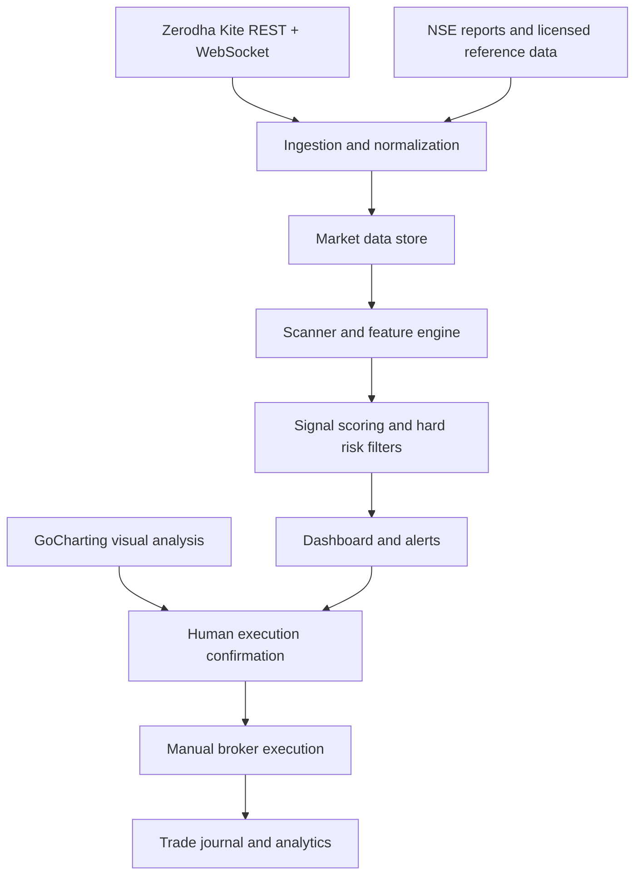

# IADEW — Institutional Activity Detection & Execution Workstation

A Windows-first, research and alerting workstation for NSE cash equities and index futures using Zerodha Kite Connect and GoCharting for visual order-flow confirmation.

> Version 0.1 is alert-only. It does not place orders. Scanner scores rank candidates; they are not probabilities and do not identify institutional participants.

## Selected stack

- Windows 10/11, Python 3.11+
- Zerodha Kite Connect: instrument master, historical candles and WebSocket quotes (subject to subscription and API terms)
- GoCharting: visual footprint, CVD, volume profile and DOM confirmation; use only documented/export-permitted data access
- Python, pandas, NumPy, FastAPI (next phase)
- SQLite initially; PostgreSQL/TimescaleDB when required
- Streamlit local dashboard; Telegram notifications in a later phase

## Architecture

## Implementation flow

1. Establish Kite authentication and refresh the instrument master.
2. Build a liquid NSE cash and index-futures universe.
3. Load historical 5-minute candles and calculate time-of-day RVOL, VWAP, EMA trend, momentum and traded value.
4. Persist scans and show ranked candidates in a local dashboard.
5. Add WebSocket ingestion, data-health checks and incremental bar construction.
6. Add independently sourced aggressor-side trade data before calculating true delta/CVD/footprint. Do not infer these from OHLCV candles.
7. Add liquidity sweeps, absorption candidates, volume-profile context and futures OI/basis features.
8. Add evidence-based setup scoring, hard risk gates and alert deduplication.
9. Paper trade, model costs/slippage, walk-forward test and review out-of-sample results.
10. Keep order entry manual in v1; review current SEBI/exchange/broker rules before any automated order routing.

## Data truth and limitations

- OHLCV-derived RVOL/VWAP/EMA are context features, not institutional-flow evidence.
- Five-level depth is displayed resting liquidity, not a complete order book and not executed aggressor volume.
- OI changes do not identify the participant or prove direction by themselves.
- Footprint/CVD quality depends on the provider's trade-side classification and licensed feed.
- Do not scrape GoCharting or reverse-engineer private endpoints.

## Local setup

See [docs/INSTALL_WINDOWS.md](docs/INSTALL_WINDOWS.md), [docs/DATA_ARCHITECTURE.md](docs/DATA_ARCHITECTURE.md), [docs/SCANNER_SPEC.md](docs/SCANNER_SPEC.md), [docs/RISK_ENGINE.md](docs/RISK_ENGINE.md), and [docs/IMPLEMENTATION_ROADMAP.md](docs/IMPLEMENTATION_ROADMAP.md).

Copy `.env.example` to `.env`; never commit credentials. See `.gitignore`.

## Repository status

Architecture and starter scanner are being added incrementally. Treat all scores and examples as research scaffolding until independently validated. No live-trading performance is claimed.

## License and data

Source code license and market-data redistribution rights must be reviewed before public reuse. Market data remains subject to the relevant provider/exchange terms.
