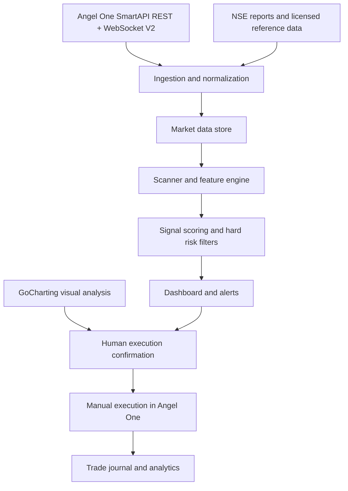

# IADEW — Institutional Activity Detection & Execution Workstation

A Windows-first research and alerting workstation for NSE cash equities and index futures using **Angel One SmartAPI** and GoCharting for visual order-flow confirmation.

> Version 0.2 is alert-only. It does not place orders. Scanner scores rank candidates; they are not probabilities and do not identify institutional participants.

## Selected stack

- Windows 10/11, Python 3.11+
- Angel One SmartAPI: TOTP login, daily scrip master, historical candles and WebSocket V2 quotes
- GoCharting: visual footprint, CVD, volume profile and DOM confirmation; use only documented/export-permitted data access
- Python, pandas, NumPy
- SQLite initially; PostgreSQL/TimescaleDB when required
- Streamlit local dashboard; Telegram notifications in a later phase

## Architecture

## Implementation flow

1. Authenticate with Angel One SmartAPI using API key, client code, PIN and TOTP.
2. Download/cache Angel One's official daily OpenAPIScripMaster instrument file.
3. Resolve NSE cash symbols to their Angel One symbol tokens and front-month NIFTY/BANKNIFTY futures to NFO tokens.
4. Load historical 5-minute candles and calculate time-of-day RVOL, VWAP, EMA trend, momentum and traded value.
5. Use the SmartAPI WebSocket V2 adapter for live quote streaming; normalize packets before feature updates.
6. Add independently sourced aggressor-side trade data before calculating true delta/CVD/footprint. Do not infer these from OHLCV candles.
7. Add liquidity sweeps, absorption candidates, volume-profile context and futures OI/basis features.
8. Add evidence-based setup scoring, hard risk gates and alert deduplication.
9. Paper trade, model costs/slippage, walk-forward test and review out-of-sample results.
10. Keep order entry manual in v1; review current SEBI/exchange/broker rules before any automated order routing.

## Data truth and limitations

- OHLCV-derived RVOL/VWAP/EMA are context features, not institutional-flow evidence.
- SmartAPI WebSocket quote/depth packets provide market-data snapshots, not a complete sequenced order-event feed.
- OI changes do not identify the participant or prove direction by themselves.
- Footprint/CVD quality depends on the provider's trade-side classification and licensed feed.
- Do not scrape GoCharting or reverse-engineer private endpoints.

## Local setup

See [docs/INSTALL_WINDOWS.md](docs/INSTALL_WINDOWS.md), [docs/DATA_ARCHITECTURE.md](docs/DATA_ARCHITECTURE.md), [docs/SCANNER_SPEC.md](docs/SCANNER_SPEC.md), [docs/RISK_ENGINE.md](docs/RISK_ENGINE.md), and [docs/IMPLEMENTATION_ROADMAP.md](docs/IMPLEMENTATION_ROADMAP.md).

Copy `.env.example` to `.env`; add Angel One credentials locally. Never commit `.env`.

## Repository status

Angel One historical-data scanner, TOTP login helper and WebSocket V2 adapter are starter integrations. They still require validation with the account owner's SmartAPI app and live session. Treat all scores as research scaffolding until independently validated. No live-trading performance is claimed.

## Official references

- [Angel One SmartAPI documentation](https://smartapi.angelone.in/docs)
- [Angel One official Python SDK](https://github.com/angel-one/smartapi-python)
- [Angel One instrument master](https://margincalculator.angelone.in/OpenAPI_File/files/OpenAPIScripMaster.json)

Market data remains subject to the relevant provider/exchange terms.
