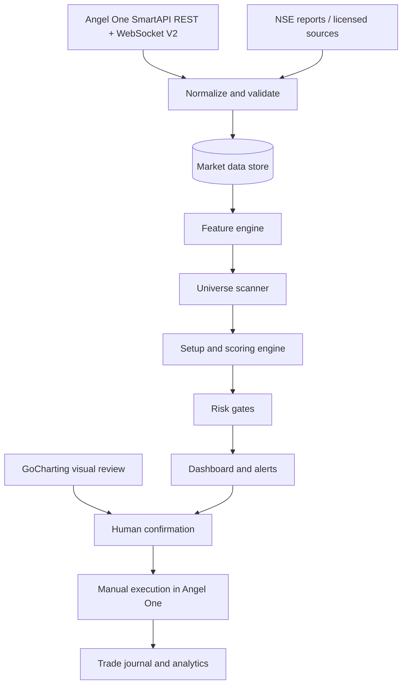

# IADEW system architecture

## Goals
A Windows-first workstation for NSE cash equities and index futures. It detects candidate conditions, ranks them, explains evidence and alerts the trader. The trader approves and places orders manually.

## Components
1. **Broker connector:** Angel One SmartAPI REST for authentication, scrip master resolution and historical candles; SmartAPI WebSocket V2 for live quote packets.
2. **Reference data:** official NSE reports and other licensed sources for aggregate participant context.
3. **Chart review:** GoCharting for visual footprint/DOM review using documented and permitted product features.
4. **Ingestion:** normalize timestamps to Asia/Kolkata, maintain exchange calendar and instrument/expiry mapping, deduplicate and detect gaps.
5. **Storage:** SQLite for MVP; PostgreSQL/TimescaleDB when scale requires it.
6. **Feature engine:** OHLCV context, VWAP, time-of-day RVOL, relative traded value, EMA/ATR, volume profile and futures OI/basis. True delta/CVD/footprint require trade-level aggressor-side data.
7. **Scanner and signals:** universe eligibility, market regime, candidate generation, named setups, evidence, score, invalidation and expiry.
8. **Risk engine:** sizing, portfolio exposure, daily loss lockout, stale-data gate and manual kill switch.
9. **Presentation:** Streamlit MVP; later service/UI separation and alerts.
10. **Human execution:** chart inspection and manual broker order entry. No order placement in v1.

## Data flow

## Deployment
- Windows 10/11 local workstation and Python virtual environment.
- `.env` for API key, client code, PIN, TOTP secret and session tokens; never commit it.
- Daily official Angel One scrip master cache in `data/`.
- SQLite in `data/` for MVP; local backups.
- Structured logs with timestamp, source, instrument token, strategy version and data-quality state.

## Non-goals for v1
- No broker order placement.
- No claim to identify a bank, FII or individual institution.
- No scraping or reverse engineering of GoCharting.
- No synthetic footprint delta from candle volume.
